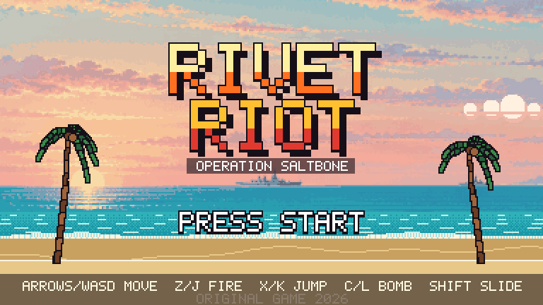
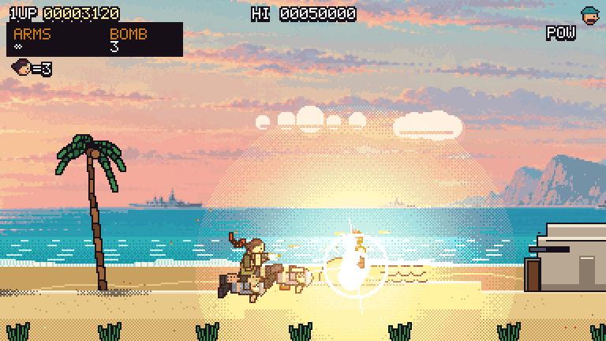
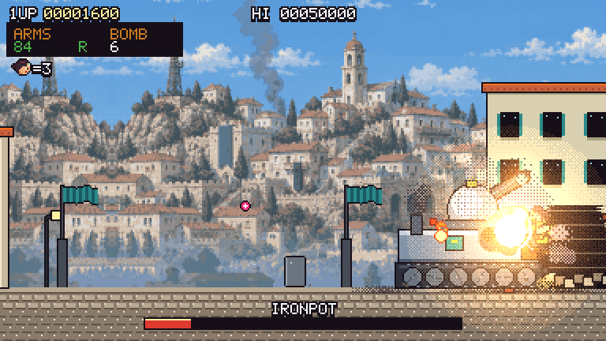
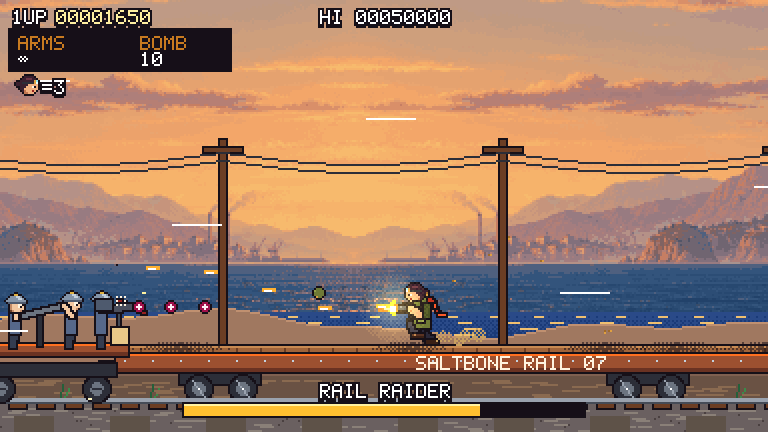
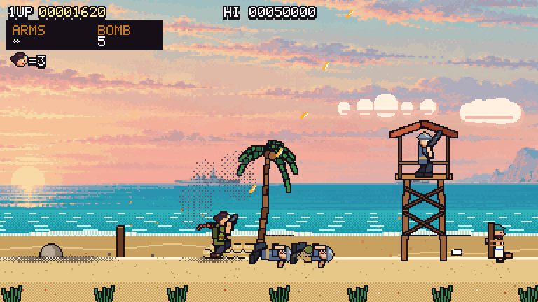
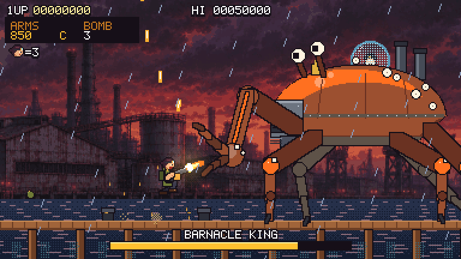
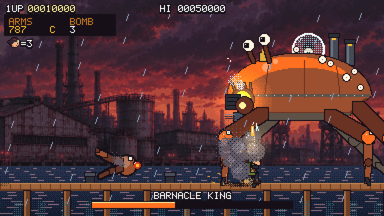

<div align="center">



# RIVET RIOT: Operation Saltbone

**짧고 밀도 높은 오리지널 2D 횡스크롤 런앤건**




</div>

철갑 군사정권 **틴 크라운(Tin Crown)** 이 점령한 항구 도시 솔트본 베이.
고글 쓴 샐비지 코만도 **리벳**이 해변에서 시작해 구시가지, 해안 열차를 지나 통조림 공장 부두의 거대 게 전차 **바너클 킹**까지 돌파합니다.

**[브라우저에서 바로 플레이](https://legerdo.github.io/RunandGun/)** · [GitHub 저장소](https://github.com/Legerdo/RunandGun) · [버그 수정 및 검증 기록](docs/BUGFIXES.md)

## 스크린샷

| 구시가지 — 중간 보스 IRONPOT | 해안선 열차 추격전 |
|:---:|:---:|
|  |  |
| **해변 — 첫 교전과 감시탑** | **최종 보스 바너클 킹** |
|  |  |

<p align="center">
  <br>
  <sub>집게를 부수면 장갑이 날아가고 노출된 용광로 코어가 약점이 됩니다.</sub>
</p>

## 빠른 시작

### Windows

`run.bat`을 더블클릭하세요. 처음 한 번은 의존성을 설치하고 빌드한 뒤 브라우저가 자동으로 열립니다.

```bat
run.bat          :: 필요하면 빌드한 뒤 실행 (http://localhost:4173)
run.bat build    :: 소스를 수정했을 때 강제로 다시 빌드
run.bat dev      :: 개발 서버 (핫 리로드, http://localhost:5173)
```

> **필요 사항:** [Node.js](https://nodejs.org/) 20.19+ 또는 22.12+

### 직접 실행

```bash
npm install
npm run dev        # 개발 서버
npm run build      # dist/ 에 프로덕션 빌드
npm run preview    # 빌드 결과 실행
```

## 조작법

| 동작 | 키보드 | 게임패드 |
|---|---|---|
| 이동 / 위 조준 / 앉기 | 방향키 또는 `WASD` | 스틱 / 십자키 |
| 사격 (근접 시 칼) | `Z` 또는 `J` | X / RT |
| 점프 (아래 + 점프: 발판 내려가기) | `X`, `K`, `Space` | A |
| 수류탄 | `C` 또는 `L` | B / Y |
| 슬라이딩 (짧은 무적) | `Shift` 또는 `V` | LB / RB |
| 일시정지 | `Enter`, `Esc`, `P` | Start |

공중에서 아래를 누르면 아래로 쏩니다. 목숨 3개, 한 방에 사망, 컨티뉴는 무제한입니다.

## 특징

**무기 5종 — 숫자가 아니라 손맛이 다릅니다**

| 무기 | 특징 |
|---|---|
| 권총 | 무한 탄. 연타가 홀드보다 빠름 |
| 체인건 `C` | 조준 방향을 바꾸면 총구가 휘돌며 부채꼴로 쓸어버림. 맞은 적은 경직 |
| 스캐터 캐논 `S` | 근거리 6발 산탄. 적을 날려버리고 짧은 히트스톱 |
| 부머 로켓 `R` | 가속하며 유도. 폭발로 적이 공중에 떠서 그을림 |
| 화염방사기 `F` | 불붙은 적이 비명 지르며 뛰어다니다 재가 됨 |

**행동이 다른 적들**

- **소총병** — 서서 쏘면 앉아서 피하고, 무릎 꿇고 쏘면 점프로 피합니다. 쏘기 전에 총구가 번쩍입니다.
- **척탄병** — 모래주머니 뒤에서 포물선으로 던집니다.
- **방패병** — 정면 사격을 튕겨냅니다. 뒤로 넘어가거나 수류탄, 로켓으로 방패를 부숩니다.
- **바주카병** — 느린 로켓은 쏴서 떨어뜨릴 수 있습니다.
- **마체테 돌격병** — 달려와 도약 베기 후 비틀거리는 빈틈이 생깁니다.
- **자이로콥터** — 폭탄을 떨어뜨리고, 격추되면 조종사가 탈출합니다.
- **기관총 진지 · 벙커** — 벙커는 부술 때까지 병력을 계속 내보냅니다.

적은 공격 종류에 따라 다르게 죽습니다(총탄, 폭발, 산탄, 칼, 화염). 대기 중인 적은 모닥불에서 생선을 굽거나 일광욕을 하다가 플레이어를 보면 놀라 튀어 오르고, 발밑에 수류탄이 떨어지면 도망칩니다.

**반응하는 환경**

부서지는 나무상자, 연쇄 폭발하는 드럼통, 깎여 나가는 모래주머니, 무너지는 감시탑과 발코니, 폭발에 깨지는 창문, 날아가는 갈매기, 도망치는 게. 해변 난파선 어딘가에는 숨겨진 포로가 있습니다.

**스테이지 흐름**

1. **솔트본 해변** — 느긋한 적들로 시작 → 모래주머니 방어선 → 감시탑 → 벙커 공략
2. **구시가지** — 발코니 저격병, 방패병, 기관총 진지, 조용한 카페 거리, 문에서 튀어나오는 매복, 전차 **IRONPOT**
3. **해안선 열차** — 달리는 화물차 위에서 육교 강하병, 추격 레일 카트, 건십 **HORNET**
4. **통조림 부두** — 폭풍 속 부두에서 바다를 가르고 올라오는 **바너클 킹**

**3페이즈 최종 보스**

| 페이즈 | 내용 |
|---|---|
| 1 | 장갑 몸체는 탄을 튕겨내고 집게가 약점. 내려찍기(충격파 점프), 하단/상단 휘두르기, 박격포, 거품 기뢰 |
| 2 | 집게가 부두에 떨어지고 장갑이 날아감. 노출된 코어, 벨리 개틀링 부채탄, 자폭 게 로봇 |
| 3 | 불타는 몸체, 금 간 조종석 돔, 눈 레이저가 부두를 따라 화염벽을 밀고 옴 |

격파하면 슬로모션 연쇄 폭발, 조종석 돔이 튕겨 나가고 거대한 물기둥과 함께 가라앉습니다. 이후 점수, 구출 포로, 명중률, 시간, 랭크가 표시됩니다.

## 기술 구성

- **소프트웨어 픽셀 렌더러** — 384×216 해상도의 모든 픽셀을 `Uint32Array`에 직접 그립니다. 번쩍임, 디더 투명도, 가산 조명, 회전 스프라이트를 픽셀 단위로 처리하고 정수 배율로 확대합니다.
- **코드로 그리는 애니메이션** — 캐릭터는 2본 IK 관절 스켈레톤과 손으로 찍은 픽셀 머리 스프라이트로 매 프레임 조립됩니다. 예비 동작, 반동, 착지 찌그러짐, 스카프 물리(verlet), 몸 기울기 스프링이 여기서 나옵니다.
- **게임 필** — 60Hz 고정 스텝, 히트스톱, 슬로모션, 화면 흔들림과 방향성 카메라 킥, 버퍼 입력과 코요테 타임. 큰 대상은 흰색 대신 옅은 틴트로 깜빡이고, 전체 화면 번쩍임은 빈도를 제한합니다.
- **사운드** — 효과음 50여 종은 시작 시 합성하고, 음악은 자체 스텝 시퀀서로 재생합니다(스테이지, 열차, 보스, 징글).

```
src/
├─ engine/      surface(렌더러) · font · input · audio(합성 SFX, 시퀀서, 보이스) · assets
└─ game/        world · player · weapons · enemies · vehicles · boss · props · decor · stage · ui · music
public/
├─ bg/          원경 레이어 (처리된 이미지)
└─ voice/       보이스 라인 (mp3)
tools/          Playwright 테스트 하네스, 에셋 처리 스크립트
run.bat         Windows 실행기
```

## 에셋 출처

| 에셋 | 방법 |
|---|---|
| 캐릭터, 적, 보스, 이펙트, UI, 폰트 | 전부 코드로 직접 제작 |
| 원경 배경 4장 | Codex CLI 이미지 생성 → `tools/process_bg.py`로 축소 및 팔레트 감축 (원본: `art/raw/`) |
| 보이스 22종 | [Fish Audio](https://fish.audio/) TTS, 유명 캐릭터 모사가 아닌 일반 커뮤니티 보이스 사용 → ffmpeg로 무음 제거와 음량 정규화 |
| 효과음, 음악 | Web Audio로 런타임 합성 |

보이스를 다시 만들려면 API 키를 환경 변수로만 넣습니다(파일에 저장되지 않습니다).

```powershell
$env:FISH_API_KEY = "<your key>"
python tools/gen_voices.py --force
python tools/check_voices.py   # faster-whisper로 대사 내용 검증
```

## 테스트

`tools/play.mjs`가 헤드리스 Chromium에서 `window.__rr` 훅으로 게임을 한 프레임씩 구동하며 입력과 스크린샷을 처리합니다.

```bash
npm run dev
node tools/play.mjs full --god      # 자동 조종 봇으로 전체 스테이지 클리어
node tools/play.mjs mortal          # 무적 없이 플레이, 사망 위치와 원인 집계
node tools/play.mjs flow            # 타이틀 → 사망 → 컨티뉴 → 게임오버 → 타이틀
node tools/play.mjs anim            # 주인공 애니메이션 확대 시트
```

URL 파라미터: `?section=0~3`(구간 바로 시작), `?god`(무적), `?mute`(음소거)

## GitHub Pages 배포

`main`에 변경을 푸시하면 [GitHub Actions](https://github.com/Legerdo/RunandGun/actions/workflows/pages.yml)가 Node.js 24에서 `npm ci`와 `npm run build`를 실행하고 `dist/`를 Pages에 배포합니다. `docs/`는 문서와 스크린샷을 보관합니다.

공개 빌드의 전체 진행을 재검증하려면 다음 명령을 사용합니다.

```bash
node tools/play.mjs full --god --url=https://legerdo.github.io/RunandGun/
node tools/play.mjs flow --url=https://legerdo.github.io/RunandGun/
node tools/play.mjs deathVoice --audio --url=https://legerdo.github.io/RunandGun/
```

## 알려진 문제

- 게임패드 입력은 구현되어 있지만 실제 컨트롤러로 확인하지 못했습니다.
- 난이도와 조작감은 자동 봇과 화면 캡처로 조정했으며, 사람이 직접 플레이해 다듬는 과정은 거치지 않았습니다.
